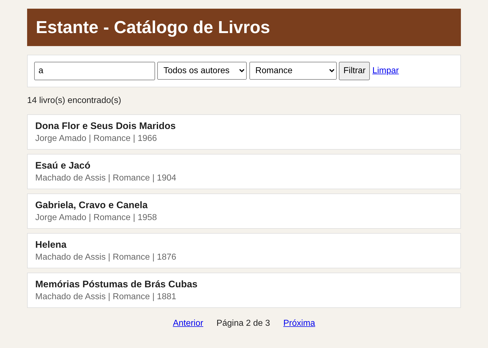

# Estante - Catálogo de Livros

Atividade 20 - Consultas ORM, Filtros e Paginação no Django
Disciplina: Programação para Internet (IFRN - Campus Pau dos Ferros)

## Integrantes

- Samuel (GitHub: [SamuelFCD](https://github.com/SamuelFCD))
- Vitor (GitHub: [gabrieldntss](https://github.com/gabrieldntss))

## Tema

**Catálogo de Livros**, com os modelos `Livro`, `Autor` e `Genero`.

- `Livro` tem título, ano, uma chave estrangeira para `Autor` e outra para `Genero`.
- Dados cadastrados: 23 livros, 6 autores e 4 gêneros.

## Filtros implementados

A página inicial (`/`) lista os livros com autor, gênero e ano. O formulário usa o método **GET**, então tudo fica na URL (exemplo: `/?page=2&busca=a&genero=1`).

1. **Pesquisa por título:** campo de texto `busca`. A view usa `titulo__icontains`, que ignora maiúsculas e minúsculas.
2. **Filtro por autor:** `<select name="autor">`. Envia o ID do autor e a view usa `filter(autor__id=...)`.
3. **Filtro por gênero:** `<select name="genero">`. Envia o ID do gênero e a view usa `filter(genero__id=...)`.

Os três funcionam sozinhos ou juntos, porque cada filtro só é aplicado se tiver valor.

**Paginação:** feita com `Paginator`, 5 livros por página, com links Anterior e Próxima, a página atual e o total de páginas ("Página 2 de 3"). A paginação é aplicada **depois** dos filtros.

**Preservação dos filtros:** os links Anterior e Próxima repetem `busca`, `autor` e `genero` na URL (com `urlencode`). Os campos do formulário também continuam preenchidos depois de filtrar.

## Captura de tela

Pesquisa "a" + gênero Romance, na página 2 de 3:



## Como rodar

```bash
python -m venv .venv
source .venv/bin/activate        # Windows: .venv\Scripts\activate
pip install -r requirements.txt
python manage.py migrate
python manage.py carregar_livros
python manage.py runserver
```

Abra http://127.0.0.1:8000/

Os livros também podem ser cadastrados pelo Django Admin (`python manage.py createsuperuser` e depois `/admin/`).

## Estrutura

```
estante/                    configurações do projeto
catalogo/
  models.py                 Autor, Genero, Livro
  admin.py                  Django Admin
  views.py                  lista_livros (busca, filtros e paginação)
  urls.py
  templates/catalogo/lista.html
  management/commands/carregar_livros.py
```

Tecnologias: Python, Django 5.2, SQLite.
